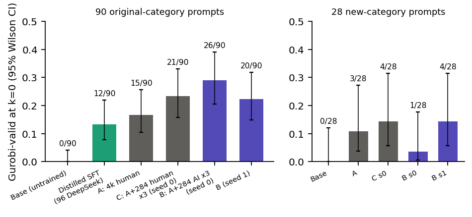

# You Get What You Verify

**Physics checkers teach small models stability, not meaning.**
CS182 (UC Berkeley, Fall 2026) project — code, data and results for the paper in [`paper/`](paper/).

Large language models placed inside a physics-checking harness (generate → verify → repair) build LEGO structures that are both stable and recognizable. We ask whether that ability transfers to small models (Qwen2.5-1.5B) through in-context examples and through supervised distillation. It transfers only partly: **only the property the verifier checks carries over**. Students learn to make stable structures, and they make them by stacking pillars and blocks that no one can recognize.



## Key results

Gurobi-checked physics-valid rate, one-shot (k=0), on 90 prompts from the 21 StableText2Brick categories. All students are Qwen2.5-1.5B-Instruct with LoRA r16, 304 steps (training data differs by group).

| Student (training data) | Valid / 90 | Wilson 95% CI | Valid / 28 new-category |
|---|---|---|---|
| Base (untrained) | 0 | [0%, 4%] | 0 |
| Distilled, 96 DeepSeek samples (12 steps) | 12 | [8%, 22%] | – |
| **A**: 4000 human | 15 | [9%, 25%] | 3 |
| **B**: A + 284 verified AI × 3, seed 0 | 26 | [20%, 39%] | 1 |
| **B**: same, seed 1 | 20 | [15%, 32%] | 4 |
| **C**: A + 284 extra human × 3 (size-matched control) | 21 | [16%, 33%] | 4 |

- **AI data ≈ human data.** No pairwise difference between B and C is significant (Fisher p = 0.50 and 1.0). The teacher is not the bottleneck; the training signal is.
- **Valid ≠ meaningful.** Blind top-1 recognition (21 classes) of the physics-valid student outputs: **0/14** for the distilled student (vs 12/14 for matched dataset structures) and **0/82** across A, B (2 seeds) and C.
- **Teachers can build.** Opus inside the harness: 187/200 pass the checker. Blind recognition of teacher outputs is 60–90% top-1, vs 75% for dataset structures.
- **Voxel IoU cannot see the failure.** Random pairs of dataset structures score 0.151, no lower than real outputs.

Full statistics: [`results/paper/stats_table.md`](results/paper/stats_table.md) · Gurobi re-check: [`results/paper/gurobi_all.json`](results/paper/gurobi_all.json) · Recognition: [`results/paper/recog/summary.json`](results/paper/recog/summary.json).

## Repository layout

```
brickexp/            core library
  checker.py           parse + verify a brick list (format, bounds, collision, floating, Gurobi static equilibrium)
  stability_patched.py BrickGPT-style Gurobi stability LP (NumericFocus=3)
  data.py, prompts.py  StableText2Brick loading (Hugging Face) and prompt construction
  train_sft.py         LoRA SFT (chunked cross-entropy, Kaggle/Colab T4-friendly)
  eval_2x2.py          evaluation (vLLM / HF / replay backends), k-round checker feedback, summary tables
  evaluate.py, backends.py, val_loss.py, rejudge.py, analysis.py
  tiny/ screen/ truss/ side studies (from-scratch tiny model; conformal GNN screener; truss FEM) — see docs/RESEARCH_LOG.md
tools/               data building, teacher harnesses, rendering, notebook builders, Kaggle/Colab push helpers
notebooks/           the exact Kaggle/Colab notebooks used for training and evaluation
data/                small data files (teacher-generated structures, eval subsets); large mixes are rebuilt by script
results/             curated evaluation outputs, logs, re-checks and reports (see docs/EXPERIMENTS.md)
paper/               main.tex, refs.bib, figs/, make_figs.py
docs/                RESEARCH_LOG.md, PREREGISTRATION.md, EXPERIMENTS.md
tests/               unit tests (checker, screener, truss FEM)
```

## Setup

```bash
python -m venv .venv && source .venv/bin/activate      # Python ≥ 3.10
pip install -r requirements.txt
bash tools/fetch_vendor.sh                              # BrickGPT (MIT) at the pinned commit; needed by brickexp/checker.py
```

- **Figures and tables need only** `numpy scipy matplotlib pillow` — every number they use is cached in `results/`.
- **Gurobi** (`gurobipy` + a license) is needed only to *re-run* the Gurobi physics re-check. See [Gurobi: what needs it, how to get it, and what runs without it](#gurobi-what-needs-it-how-to-get-it-and-what-runs-without-it).
- **GPU** (one 16 GB T4 is enough) is needed only to retrain or re-evaluate students.

## Gurobi: what needs it, how to get it, and what runs without it

The paper's headline physics numbers ("Gurobi-checked") come from a static force-balance linear program solved with [Gurobi](https://www.gurobi.com/). Everything else, including every figure and table, runs without it.

### What needs a working Gurobi license

| Script / mode | Used for in the paper | Without a license |
|---|---|---|
| `python results/paper/gurobi_all.py` | the Gurobi-checked counts behind Fig. 4 and the results tables (`results/paper/gurobi_all.json`) | fails on purpose (it refuses to fall back) |
| `python results/mix_gurobi_recheck.py` | first Gurobi re-check of runs A/B/base | fails |
| `python -m brickexp.rejudge` | re-judges online-accepted attempts with Gurobi | exits with a message |
| `brickexp.checker.check(..., use_gurobi=True)` | strict mode used by the scripts above | raises `GurobiUnavailable` |
| `python -m brickexp.evaluate` / `python -m brickexp.eval_2x2 run` | student evaluation | default is `--checker gurobi`; pass **`--checker connectivity`** (this is what the Kaggle/Colab notebooks used) |
| `python -m brickexp.screen.labels`, `python -m brickexp.screen.diag rerun` | stability labels for the conformal screener (appendix) | not runnable; labels are cached in `results/screen*/` |
| `python -m brickexp.tiny.gen_data --unstable` | mining "unstable" bad bricks for the tiny models (appendix) | drop `--unstable` (cheap failure types need no solver) |
| `data/opus_gen/*/gen.py`, `tools/harness_vision.py`, `tools/distill_pilot.py` | teacher harness that produced the AI-built data | not runnable; outputs are cached in `data/opus_gen/` and `results/` |

### What runs without Gurobi (and how)

1. **All figures and tables** read cached Gurobi results from `results/`:
   ```bash
   python tools/reproduce_all.py        # ~20 s on CPU, no GPU, no license
   ```
2. **Independent re-check of the cached student outputs** with the solver-free connectivity checker (format, bounds, collision, floating, connectivity; no force balance):
   ```bash
   python tools/recheck_connectivity.py # ~10 s on CPU
   ```
   This reproduces the connectivity counts reported in the paper (e.g. 90 prompts: A 17, B 27 / 22, C 21; 300 prompts: base 2, A 44 / 70, B 66 / 80, C 56 / 63). Gurobi counts are equal or lower because the LP additionally rejects statically unstable structures.
3. **The checker itself:** `check(text, use_gurobi=False)` always uses connectivity. `use_gurobi="auto"` (the default) uses Gurobi when a license works and connectivity otherwise; the result's `.method` field records which one ran.
4. **Training and evaluating students** (GPU): use `--checker connectivity`, exactly as in the notebooks in `notebooks/`.
5. **Tests:** `python -m pytest -q tests`. Tests that need Gurobi skip themselves.

There is no alternative LP solver wired in: the force-balance model is BrickGPT's Gurobi formulation (`brickexp/stability_patched.py`). We use connectivity as the documented fallback instead.

### Getting a free academic license

Gurobi is free for academic use. Either license works:

- **Named-user academic license** (your own machine): register with your university email at <https://www.gurobi.com/academia/academic-program-and-licenses/>, request an *Academic Named-User License*, then run the `grbgetkey <key>` command it shows **while on the campus network or VPN**. This writes `gurobi.lic` to your home directory.
- **Academic Web License Service (WLS)** (works in containers, Colab and Kaggle; this is what we used): request a *WLS Academic* license on the same page, then download `gurobi.lic` from the [Gurobi Web License Manager](https://license.gurobi.com/). It contains `WLSACCESSID`, `WLSSECRET` and `LICENSEID`.

Then:

```bash
pip install gurobipy                         # already listed (optional) in requirements.txt
export GRB_LICENSE_FILE=/path/to/gurobi.lic  # only if the file is not in your home directory
python -c "from brickexp.checker import gurobi_available; print(gurobi_available())"   # should print True
```

Note that the size-limited license bundled with `pip install gurobipy` is **not** enough: `gurobi_available()` deliberately solves a 2,500-variable model, which the bundled license rejects, so the checker falls back to connectivity. Never commit `gurobi.lic` (it is in `.gitignore`).

On a heavily loaded CPU Gurobi occasionally times out on single structures. `gurobi_all.py` retries up to 3 times, so the counts are stable across reruns.

## Reproducing every figure and table

All commands run from the repository root.

| Paper item | What it shows | Command | Inputs (all in repo) |
|---|---|---|---|
| Fig. 1 `pipeline.pdf` | harness/distillation pipeline | `python paper/make_figs.py` | — |
| Fig. 2 `recognition.pdf` | blind top-1 recognition, Wilson CIs | `python paper/make_figs.py` | counts from `results/recognition_eval/REPORT.md`, `results/recognition_eval_sft_v2/` |
| Fig. 3 `opus_gallery.pdf` | teacher structures, new categories | `python paper/make_figs.py` | `data/opus_gen/newcat_{0,1}/renders/` |
| Fig. 4 `physics_valid.pdf` | Gurobi-valid rates (90 + 28 prompts) | `python paper/make_figs.py` | `results/paper/gurobi_all.json` |
| Fig. 5 `train_curves.png` | training loss A, B×2, C | `python results/paper/curves_stats.py && cp results/paper/train_curves.png paper/figs/` | `results/*/sft_*/train_log.json` |
| (alt) `train_curve.pdf` | same, compact | `python paper/make_figs.py` | same |
| Fig. 6 `solid_vs_human.pdf` | valid distilled outputs vs dataset | `python paper/make_figs.py` | `results/recognition_eval_sft_v2/renders/` |
| Results table + Appendix stats | rates, Wilson CIs, Fisher tests | `python results/paper/curves_stats.py` → `results/paper/stats_table.md`, `stats.json` | `results/paper/gurobi_all.json` |
| Gurobi re-check (source of all valid counts) | k=0 re-check of every student run | `python results/paper/gurobi_all.py` *(needs Gurobi)* | `results/{mix_A,mix_B,final_small}/runs/*.jsonl` |
| Connectivity re-check (no Gurobi) | k=0 validity of every cached run, solver-free | `python tools/recheck_connectivity.py` | eval jsonl in `results/` |
| Recognition (0/82) | blind sheets + scoring | `python results/paper/recog/build.py` | eval jsonl + `results/paper/recog/*/judgments.jsonl` |
| 96-sample distillation 2×2 | 0→12/90 | see `results/distill_sft/REPORT.md` | `results/distill_sft/runs/` |
| Hyperparameter table (App.) | — | static, from `notebooks/kaggle_mix_*.ipynb` | — |

All of the above at once (no Gurobi or GPU needed):

```bash
python tools/reproduce_all.py
```

To compile the paper, upload `paper/` to Overleaf, or run `latexmk -pdf main.tex` inside `paper/` (it uses `neurips_2025.sty`).

## Rebuilding data and re-running training

```bash
python tools/fetch_stabletext2brick.py                 # downloads StableText2Brick from Hugging Face into data/hf_cache
python tools/build_mix_data.py                         # data/mix/A.jsonl, B.jsonl, C.jsonl (+ newcat_test_eval.jsonl, manifest.json)
python tools/build_final_data.py                       # data/mix/FA/FB/FC.jsonl (§4n Gemini paired design; not used in the paper)
```

Train and evaluate one group, using the settings from `notebooks/kaggle_mix_A.ipynb`:

```bash
python -m brickexp.train_sft --model Qwen/Qwen2.5-1.5B-Instruct --data_jsonl data/mix/A.jsonl --out out/sft_A \
       --bs 2 --grad_accum 8 --max_len 3072 --rank 16 --lr 2e-4 --max_steps 304 --seed 0
python -m brickexp.eval_2x2 run --backend vllm --max_budget 0 --checker connectivity --limit 0 \
       --model out/sft_A/merged --tag A_90 --out_dir out/runs
python results/paper/gurobi_all.py                     # re-judge the outputs with Gurobi (authoritative)
```

The `notebooks/` directory contains the exact notebooks that ran on Kaggle/Colab. `tools/build_*_notebook.py` regenerates them, and `tools/kaggle_*_push.py` pushes them. Credentials are read from your own environment (Kaggle API token, Gurobi WLS secrets as Kaggle Secrets); none are included here.

## Pre-registration

The A/B/C comparison and the recognition protocol were pre-registered before any result was downloaded. The rules are in [`docs/PREREGISTRATION.md`](docs/PREREGISTRATION.md), and every deviation is recorded in [`docs/RESEARCH_LOG.md`](docs/RESEARCH_LOG.md).

## What is not in this repository (and why)

| Omitted | Reason | How to get it |
|---|---|---|
| LoRA adapters / merged weights (`*.safetensors`, ~74 MB each) | no model weights in the repo | retrain with the commands above (~2.5 h per group on a free T4) |
| `tokenizer.json` copies in adapter folders (11 MB) | >5 MB; identical to the base model's tokenizer | download with the base model |
| `data/mix/{A,B,C,FA,FB,FC}.jsonl` (10–12 MB each) | >5 MB | `tools/build_mix_data.py`, `tools/build_final_data.py` |
| StableText2Brick (`data/hf_cache`, 3 GB) | third-party dataset | `tools/fetch_stabletext2brick.py` |
| Tiny-model per-sample evals (`results/tiny_4arm/modal_v2/*/eval.jsonl`, ~17 MB each) | >5 MB | summaries kept; rerun `brickexp/tiny` |
| Truss datasets and runs (`data/truss*`, `results/truss10*`) | ~1 GB / >5 MB | `python -m brickexp.truss.gen`, `brickexp.truss.night` |
| Early C0/C1 Kaggle runs and failed attempts | debugging history; superseded | described in `docs/RESEARCH_LOG.md` |
| Vendored BrickGPT / STABLE code | third-party | `bash tools/fetch_vendor.sh` clones both at the pinned commits |
| Free-text "self_eval" notes in teacher samples | originally written in Chinese; not used by any analysis | field kept, emptied |
| Internal chat logs, planning notes, personal information | private | — |

## License

MIT — see [LICENSE](LICENSE). StableText2Brick and BrickGPT keep their original licenses.

## Acknowledgements

We thank the CS182 course staff for feedback, and the authors of BrickGPT/StableText2Brick for releasing their data and stability analysis.
